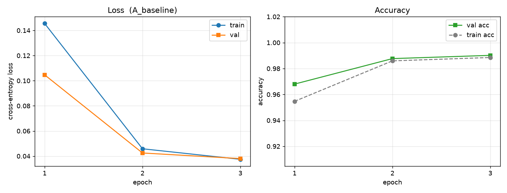

# 单卡游戏电脑上的 PyTorch 训练闭环：从环境体检到 CNN 消融实验

在一台只有 RTX 4080 Laptop（12GB）的游戏电脑上，打通「环境验证 → 数据 → 训练 → 评估 → 消融」的完整链路，为后续 7B 模型的 QLoRA 微调建立显存与时间的预算基准。

> 本仓库是大模型实习前热身计划的第 1 周产出（阶段一：体检、环境与最小可运行）。

---

## 1. 任务定义

在 MNIST 手写数字识别上训练一个小 CNN（468,202 参数），目的**不是刷精度**，而是三件事：

- 验证本地单卡环境（CUDA / cuDNN / 显存）确实可用；
- 用同一套代码跑 5 组消融，量化「学习率 / BatchNorm / Dropout」各自的影响；
- 记录每轮的显存峰值与耗时，作为后续 7B-QLoRA 训练的预算基准。

## 2. 数据来源与规模

| 项 | 内容 |
|---|---|
| 来源 | MNIST（4 个 idx 文件，共约 11 MB） |
| 规模 | 训练 54000 / 验证 6000（从 60000 训练集切 10%）/ 测试 10000 |
| 预处理 | `ToTensor()` + `Normalize((0.1307,), (0.3081,))` |
| 本地缓存 | `data/MNIST/raw/`（已列入 `.gitignore`） |

> 注：官方 `ossci-datasets.s3.amazonaws.com` 在本机实测只有 8 KB/s，
> 改用 `storage.googleapis.com/cvdf-datasets/mnist`（122 KB/s）下载后按 MD5 校验，
> 四个文件的 MD5 与 torchvision 内置的一致。手动解压后 torchvision 才认（它校验的是解压后的文件）。

## 3. 模型与训练方法

| 项 | 内容 |
|---|---|
| 模型 | 自建 `SmallCNN`：2 个卷积块（Conv-BN-ReLU ×2 + MaxPool）+ 2 层全连接 |
| 参数量 | 468,202 |
| 损失 | 交叉熵 |
| 优化器 | AdamW（weight_decay=1e-4） |
| 训练循环 | **手写**，不用 Lightning / 现成 Trainer：`zero_grad → forward → loss → backward → step` |
| 随机性控制 | 固定 seed=42（Python / NumPy / PyTorch / CUDA） |

> 本周不是微调任务，是自建模型从零训练。微调（QLoRA）在阶段四（第 6–8 周）。

## 4. 关键超参与显存

| 超参 | 值 |
|---|---|
| epochs | 3（消融 E 组为 15） |
| batch_size | 128 |
| lr | 1e-3（消融 B 组 1.0，C 组 1e-5） |
| dropout | 0.25（消融 E 组 0） |
| amp | 关闭（先建立 fp32 基准） |
| 设备 | RTX 4080 Laptop GPU，12 GB（sm_89，58 个 SM） |

**实测显存与耗时**

| 指标 | 数值 |
|---|---|
| 显存峰值 | 130 MB（12 GB 的 1%） |
| 单轮耗时 | 9.6 / 10.4 / 10.6 秒 |
| 3 轮总耗时 | 30.3 秒 |
| 矩阵乘吞吐 | fp32 19.09 / tf32 25.20 / bf16 61.05 / fp16 62.01 TFLOPS |
| bf16 ÷ fp32 | 3.20×（Tensor Core 生效） |

> 单轮 10 秒的瓶颈在 CPU 数据预处理而不是显卡：450 来个 batch、`num_workers=0`，
> GPU 利用率只有 10–20%。这个数字本身是个结论：**小模型上，数据管道比算力更容易成为瓶颈。**

## 5. 结果与对比

### 5.1 主结果

| 指标 | 数值 |
|---|---|
| 验证集最佳准确率 | 99.02% |
| 测试集准确率 | **98.92%** |
| 计划目标 | ≥ 98% |



### 5.2 消融对比表

数据直接来自 `results/runs.csv`：

| 实验 | lr | epochs | BN | Dropout | train loss | val loss | test acc | 显存峰值 |
|---|---|---|---|---|---|---|---|---|
| A 基线 | 1e-3 | 3 | ✓ | 0.25 | 0.0374 | 0.0380 | 98.92% | 130 MB |
| B 学习率过大 | 1.0 | 3 | ✓ | 0.25 | 2.3458 | 2.3775 | 11.35% | 130 MB |
| C 学习率过小 | 1e-5 | 3 | ✓ | 0.25 | 0.2369 | 0.1686 | 96.63% | 130 MB |
| D 无 BatchNorm | 1e-3 | 3 | ✗ | 0.25 | 0.0402 | 0.0451 | 98.90% | 130 MB |
| E 无 Dropout | 1e-3 | 15 | ✓ | 0 | 0.0075 | 0.0389 | 99.25% | 130 MB |

### 5.3 三个结论

**结论一：学习率过大的表现是「飞出去」，不是「慢慢变差」。**
B 组第一个 epoch 的 loss 直接冲到 **203.7**，之后卡死在 2.34 不再下降，准确率 11.35%——10 类随机猜是 10%。
这说明 lr=1.0 已远超该损失面的稳定区间（η < 2/λ_max(H)），梯度步长一步就把参数甩到了平坦区里。

**结论二：BatchNorm 在这个任务上几乎没有作用。**
D 组去掉 BN 后，测试准确率 98.90% vs 基线 98.92%，差 0.02 个百分点；第 1 轮甚至 **更** 好（val acc 97.95% vs 96.80%）。
这与教科书预期相反。原因大概是：MNIST 太简单、AdamW 本身对尺度不敏感、而且模型只有 2 个卷积块，梯度还没有深到需要 BN 来稳住。

**结论三：过拟合的「喇叭口」出现了，但它没有伤害准确率。**
E 组训练 15 轮、关掉 Dropout：`train_loss` 0.0075 只有 `val_loss` 0.0389 的 **1/5.2**，
两条曲线在图上明显张开（见 `results/curve_E_overfit.png`）。但它的测试准确率 **99.25%，是五组里最高**。
所以在这个任务上，过拟合体现为 loss 的差距，而不是精度的损失——准确率已经饱和到 99% 附近，挤不出更多信息。

> 这三条说明一件事：**消融实验不保证印证教科书。** MNIST 太简单，
> BN 和 Dropout 的价值需要在更难的数据上才显现——这正是明天换成 CIFAR-10 的理由。

## 项目结构

```
.
├── README.md
├── .gitignore
├── data/                        # MNIST 原始文件 + 解压产物（不进版本库）
├── check_env.py                 # 环境体检：显卡/显存/CUDA/吞吐
├── train_mnist_cnn.py           # 训练主脚本（手写训练循环）
├── run_experiments.ps1          # 一条命令跑完 5 组消融
└── results/
    ├── runs.csv                 # 5 组实验的配置与结果
    ├── curve.png                # 基线的训练/验证曲线
    ├── curve_<tag>.png          # 每组各自的曲线
    ├── env_report.md            # 环境体检报告
    └── last_run.json            # 最后一次运行的完整结果
```

## 复现方式

```powershell
conda activate llm
python check_env.py --markdown results\env_report.md
python train_mnist_cnn.py --epochs 3 --batch-size 128 --lr 1e-3
powershell -ExecutionPolicy Bypass -File .\run_experiments.ps1
```

## 环境

```
Windows 11 (Build 26200)
Python 3.11.18            (conda 环境 llm，conda-forge 通道)
PyTorch 2.11.0+cu128      (CUDA runtime 12.8，cuDNN 9.19)
GPU: NVIDIA GeForce RTX 4080 Laptop，12 GB，驱动 610.74
matplotlib 3.11.2
```

安装时踩到的两个坑，写在这里免得下次再犯：

1. `pip install torch torchvision matplotlib --index-url .../cu128` 会失败——`--index-url` 把源整个换掉了，那里没有 matplotlib。必须拆成两条命令。
2. `download.pytorch.org` 在本机只有 0.17 MB/s（2.6GB 要 4 小时），换南京大学镜像 `mirrors.nju.edu.cn/pytorch/whl/cu128` 后 8.16 MB/s，5 分钟装完。
