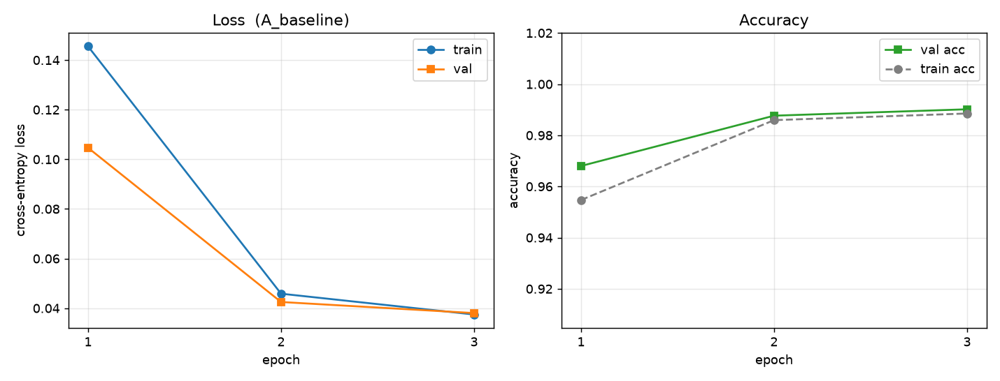

# 项目 README 模板（第一周版）

> 计划 7.1 要求 README 五项必填。这份模板就是按那五项排的，
> 填完删掉所有「> 」开头的提示行即可。

# 单卡游戏电脑上的 PyTorch 训练闭环：从环境体检到 CNN 消融实验

一句话：在一台只有 RTX 4080 Laptop（12GB）的游戏电脑上，打通「环境验证 → 数据 → 训练 → 评估 → 消融」的完整链路，为后续 QLoRA 微调建立显存与耗时的预算基准。

---

## 1. 任务定义

在 MNIST 手写数字识别上训练一个小 CNN（约 47 万参数），目的**不是刷精度**，而是：

- 验证本地单卡环境（CUDA / cuDNN / 显存）可用；
- 用同一套代码跑 5 组消融，量化「学习率 / BatchNorm / Dropout」各自的影响；
- 记录每轮的显存峰值与耗时，作为后续 7B 模型 QLoRA 训练的预算基准。

## 2. 数据来源与规模

| 项 | 内容 |
|---|---|
| 来源 | MNIST（`torchvision.datasets.MNIST` 自动下载，约 11MB） |
| 规模 | 训练 60000 / 验证 6000（从训练集切 10%）/ 测试 10000 |
| 预处理 | `ToTensor()` + `Normalize((0.1307,), (0.3081,))` |
| 本地缓存 | `data/MNIST/`（已在 `.gitignore` 里排除） |

## 3. 模型与训练方法

| 项 | 内容 |
|---|---|
| 模型 | 自建 `SmallCNN`：2 个卷积块（Conv-BN-ReLU ×2 + MaxPool）+ 2 层全连接 |
| 参数量 | 约 47 万 |
| 损失 | 交叉熵 |
| 优化器 | AdamW（weight_decay=1e-4） |
| 训练循环 | **手写**，不用 `Lightning` / 现成 Trainer：`zero_grad → forward → loss → backward → step` |
| 随机性控制 | 固定 seed=42（Python / NumPy / PyTorch / CUDA） |

> 说明：本周不是微调任务，是自建模型从零训练。微调（QLoRA）在阶段四（第 6–8 周）。

## 4. 关键超参与显存

| 超参 | 值 |
|---|---|
| epochs | 3（消融实验 E 组为 15） |
| batch_size | 128 |
| lr | 1e-3（消融 B 组 1.0，C 组 1e-5） |
| dropout | 0.25（消融 E 组 0） |
| amp | 关闭（先建立 fp32 基准） |
| 设备 | RTX 4080 Laptop GPU，12GB |

**显存与耗时实测**：

| 指标 | 数值 |
|---|---|
| 显存峰值 | 约 ____ MB |
| 单轮耗时 | 约 ____ 秒 |
| 3 轮总耗时 | 约 ____ 分钟 |
| 矩阵乘吞吐（fp32 / bf16） | ____ / ____ TFLOPS |

> 这几个数字就是后面做 7B QLoRA 时的参照系：如果 MNIST 的显存峰值都到了 3GB，
> 说明环境里还有别的东西在占卡，先查清楚再上大模型。

## 5. 结果与对比

### 5.1 主结果

| 指标 | 数值 |
|---|---|
| 验证集最佳准确率 | ____% |
| 测试集准确率 | ____% |
| 基线（计划目标） | ≥ 98% |



### 5.2 消融对比表

> 这张表直接从 `results/runs.csv` 转过来，不要手抄数字。

| 实验 | lr | epochs | BN | Dropout | train loss | val loss | test acc | 显存峰值 |
|---|---|---|---|---|---|---|---|---|
| A 基线 | 1e-3 | 3 | ✓ | 0.25 | | | | |
| B 学习率过大 | 1.0 | 3 | ✓ | 0.25 | | | | |
| C 学习率过小 | 1e-5 | 3 | ✓ | 0.25 | | | | |
| D 无 BatchNorm | 1e-3 | 3 | ✗ | 0.25 | | | | |
| E 无 Dropout | 1e-3 | 15 | ✓ | 0 | | | | |

### 5.3 三个结论

1. **学习率**：B 组 loss ____（变 nan / 震荡 / 正常），说明 AdamW 在 lr=1.0 时已超出该损失面的稳定区间。
2. **BatchNorm**：D 组相对 A 组，收敛速度 ____，最终精度差 ____ 个百分点。
3. **过拟合**：E 组的 train/val 差距为 ____，是 A 组的 ____ 倍；差距随 epoch 单调张开，就是过拟合的可观测形式。

---

## 项目结构

```
.
├── README.md
├── .gitignore
├── data/                  # 数据集（不进版本库）
├── scripts/
│   ├── check_env.py       # 环境体检
│   └── train_mnist_cnn.py # 训练主脚本
├── configs/               # 实验配置
│   └── runs.csv           # 每次运行的配置与结果
└── results/
    ├── curve.png
    ├── env_report.md
    └── last_run.json
```

## 复现方式

```powershell
conda activate llm
python scripts\check_env.py
python scripts\train_mnist_cnn.py --epochs 3 --batch-size 128 --lr 1e-3
powershell -ExecutionPolicy Bypass -File .\run_experiments.ps1
```

一条命令复现全部消融实验，见 `run_experiments.ps1`。

## 环境

```
Windows 11 (Build 26200)
Python 3.11
PyTorch 2.x + CUDA 12.x  (cu128 wheel)
GPU: NVIDIA GeForce RTX 4080 Laptop, 12GB, driver 610.74
```
